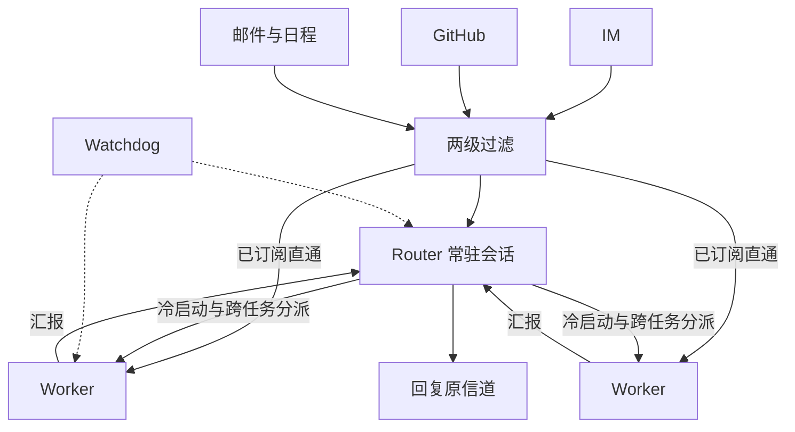
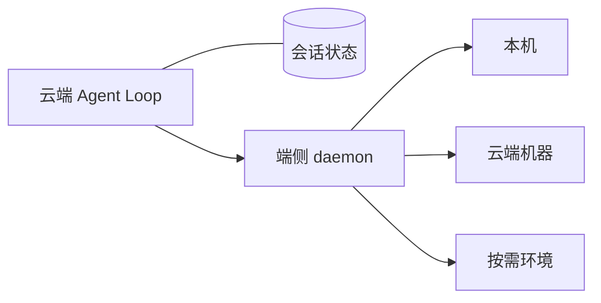

原文：DeepSeek Harness 团队，[《Super-agent 设计探索：迈向更自主的 Agent 系统》](https://mp.weixin.qq.com/s/zoS7GlReWPhfCjENGxXCdg)（2026-10-31）。系统实现和写作是 Yujia Qiao；Huanqi Cao、Zui Chen、Xieting Chu、Tianyi Cui、Shiyuan Feng、Yudong Han、Kexin Liu、Shichun Liu、Gesi Luo、Yifan Shi、Tongrui Xiong、Hanxiang Xu、C.C. Yu、Ziya Zhang、F. Zhou 参与审阅。

文首说明：这是面向工程实践的架构思路，不是 DeepSeek Harness 现有产品功能介绍。部分设计做在原型 [dsh-superagent-prototype](https://github.com/deepseek-ai/dsh-superagent-prototype) 里，用来验证技术路线，不是正式产品。

下面按原文章节记。他们内部已经有一个基于 DeepSeek Harness 的实例在跑：同一个开发任务可以在 IM 和 GitHub 之间接着做；它也会盯着公共群，没人 @ 的时候自己定位问题并提修复 PR。

## 要解决什么

过去一年，Coding Agent 已经能用工具做完复杂任务，人越来越少需要盯着每一步。多 Agent 协作也在变好，跨会话的组织和调度开始可行。人从底层执行往上移，更多做决策和验收。

个人助手是这波新形态里最显眼的一类：接上消息、日程、邮件和工作平台，持续看信息流。这种一直在线、靠事件驱动的方式，个人场景和研发协作都用得上。

现有设计还撑不住多任务和团队规模。工作单位仍是单个 Session，Session 之间互不相干。人并行推进几件事时，得自己切换、自己记得上下文在哪。他们观察到，一个人通常只能同时跟进 3 到 5 个活跃 Session。于是单任务的上限是模型，多任务的上限是人的注意力。

只在本地单会话上加 CLI、MCP 或连接器，外部消息能进来，但几个老问题还在：单会话同步阻塞、多任务上下文搅在一起、电脑休眠或离线 Agent 就停。

他们要的是另一个东西：Agent 不再绑在一次手动会话上，能跨会话留着上下文，同时推进多项复杂任务且互不干扰。这个形态和对应的系统架构，他们叫 Super-agent。

四个基础特征：

- **连续**。人在 IM、GitHub 评论这些本来就在用的界面里跟它说话，感觉始终是同一个 Agent。先在 IM 里定方案 A，再在 PR 评论里改成方案 B，它能接上并改方向。不用去想「Session X 里有没有 Y」。
- **高效**。响应要快，多个复杂任务可以并行，而且质量不能掉。上一条还没做完，下一条就能接。
- **主动**。不等逐条指令。环境里值得处理的事它自己推进；不该插手时保持安静。
- **持久**。一直在线，直接接真实工作环境，长期跑的时候出错能自己恢复。

一个 ReAct Loop 撑不起这四件事。个人助手和研发 Agent 如果都要持续在线、并发响应环境事件，底层会碰到同一类约束，也就会走出相近的架构。这些约束和传统计算机系统很像，所以很多经典设计可以直接拿来用。

五个模块对应这四个特征：

| 模块 | 解决什么 |
| --- | --- |
| 双层架构（第 2 节） | 连续交互，同时还能并发 |
| 事件驱动（第 3 节） | 主动 |
| 面向人的交互（第 4 节） | 交互过程里同时做到连续和高效 |
| 计算、状态与环境分离（第 5 节） | 跨设备持久在线 |
| Watchdog（第 6 节） | 异常自愈 |

计算、会话状态和执行环境分开：

## 2. 双层架构

跨信道连续，和多任务并发，在会话组织上是一对拉扯：连续性对上吞吐量。

每条事件都进同一个 Session，上下文最连续，但一个 ReAct Loop 只能串行，做完得慢，吞吐低，多任务的中间细节搅在一起，完成质量也会掉。

每条事件都新开 Session，并发最高。任务之间只要不完全独立，没有全局上下文，结果就彼此割裂；多个 Session 各回各的，交互也乱。

拆成两层：常驻的 Router 维护全局连续，上下文隔离的 Worker 负责并发执行。用户面对的始终是同一个 Super-agent。Session 退回实现细节。让用户自己管 Session，很大程度是 LLM API 留下来的习惯。

产品和底层 Session 解开之后，面向用户的项目管理不再受 Session 限制，交互和任务管理变成单独的产品问题，放到第 8 节。

「双层」是职责划分。每一层内部都可以再有结构，不必是一个 Session。

### 2.1 Router

Router 是常驻的全局路由层，承接所有入口上的人类交互。跨任务的信息和决策都汇总在这里。它是全局的序点（Sequence Point）、协调点和记忆。

它不直接做具体任务，甚至可以不配 Bash。这样这个全局节点才不容易变成性能瓶颈。

表面上很像 Agent Team：一个中心节点分派多个执行节点。侧重点不同。常见的 Agent Team 拆的是一个复杂任务内部的步骤，子步骤耦合紧，Team Lead 得懂细节、规划子任务、高频协调，推理负载很重。Router 只处理任务之间的高层关联和分派，不进单任务内部。反过来，如果用提示词把一个 Agent Team 的主会话约束成「自己不执行，只对外交互，把不同任务分给成员各自推进」，那也可以看成这种双层架构。他们的实践里，Router 的活常常没有想象中重，较轻的模型就能兼顾速度和效果。

Router 内部也不必是一个 Session，有些逻辑甚至不用 LLM。他们选了最直接的做法：一个常驻 LLM Session。它没有表面上看起来那么容易堵死，因为上一轮推理期间到达的 Trigger 会积下来，下一轮一起处理，形成批处理，合并的额外开销很小。

- 事件流平稳时，Trigger 逐条进 Router，单次响应延迟低。
- 事件挤在一起、Router 开始排队时，积压的多条 Trigger 自动合并进同一次 LLM 调用。Router 只做轻量交互和分派，每步通常是长输入、短输出。多条 Trigger 在 Prefill 阶段并行算，单次请求耗时的增长慢于 batch 大小。一定范围内，积压越多，单个决定分摊的推理时间越低。上限是上下文长度，以及模型一轮里能准确处理多少条 Trigger。

7.2 节给了这个机制的定量结果。再加上后面的订阅直通和链式召回，单个常驻 Router 在他们目前的团队规模下够用。

规模再上去、单个会话确实装不下时，Router 内部可以做成多层过滤，或者水平切成多个会话。切得越细，并发吞吐越高，分片之间的记忆和连续性越低。全局记忆没解决之前，这个权衡一直在。

### 2.2 Worker

Worker 是真正执行的会话。彼此上下文隔离，挂完整的执行工具，在自己的上下文里做一件事。任务结果和代码质量由 Worker 决定，所以通常配最强的模型。

Worker 不直接跟人类说话。推理过程和工具调用不输出到外部信道，状态汇报给 Router，由 Router 统一回复。并发和交付质量留住了，也不会出现好几个会话各回各的。

多个 Worker 各推各的，同层之间通常不直接通信。执行冲突多半发生在同一个 PR 这类共享环境里。只要它们都订阅了对应的 Thread，就会收到同一条事件，有机会自己发现冲突、自己解决。少数跨任务协同由 Router 中转。

每个 Worker 内部也可以再拆：复杂单任务里再开 Subagent，或者 Worker 自己就是一个 Agent Team。这些对 Router 透明。

这套结构两边都适用。代码协作里，问题复现、PR 评审、特性开发可以同时推进，互不阻塞。个人助手表面上往往只有一个聊天页，用户在同一个框里聊好几件事时，前端维持交互连续，底下按话题分 Worker，并行做任务、起草回复。

## 3. 事件驱动

要主动，先换驱动方式。主要输入不再是人在 Session 里一条条打的提示词，而是环境里的半结构化事件。群聊、邮件、日程、代码审查评论、CI 结果，都叫 Trigger。Agent 不用再等人类下指令才动一次。

一条事件从进来到处理完，他们按四个问题往下拆。

### 3.1 过滤

真实群聊和代码平台上，事件流是高噪音、低触发率。绝大多数日常消息不需要 Agent 插手。每条都叫大模型从头判断，延迟和算力都扛不住。

这里用 Fast Path / Slow Path。大模型推理是灵活但贵的 Slow Path。已经明确、稳定的高频判断写成确定性代码，就是低延迟、低成本的 Fast Path。

两级过滤，在调用大模型之前先筛掉噪音：

- **程序层（Fast Path）**。按来源、群组、用户或机器人白名单这类确定条件做准入。不同来源可以设成「只响应明确请求」「作为候选」或「直接忽略」。大部分无关消息在进模型之前就去掉。
- **语义层（Slow Path）**。过了程序层的候选交给 LLM，按提示词里的策略和上下文决定要不要行动。语义层也是给人用的扩展点：用自然语言开关或新增策略。

### 3.2 路由

如果已经分出去的任务，后续每条事件还要 Router 转发，这个全局节点照样会被打满，响应变慢。过滤之后的路由同样分成快慢两条路。Router 只负责新任务的冷启动和跨任务协调。归属已经确定的后续事件，程序直接发给对应 Worker。

同一个 GitHub PR、同一个 IM 话题、同一串往来邮件，下面的连续事件构成一条 Thread。

Router 根据某个 Thread 的初始事件创建 Worker 之后，这个 Worker 直接订阅该 Thread：

- **已订阅（Fast Path）**。同一 Thread 的后续事件直通已订阅的 Worker，Router 不用再调一次工具转发。新事件超出当前任务范围时，Worker 可以取消订阅，或交回 Router 重新分派。
- **未订阅（Slow Path）**。Router 仍能看到所有事件，用来掌握全局，但只判断和分派还没人订阅的新事件。

Thread 和 Worker 的订阅是多对多。一个 Worker 可以订多个相关 Thread，一个 Thread 也可以被多个 Worker 订。多个 Worker 在同一个工作环境或讨论里碰上时，这条 Thread 的新事件会同时直通所有订阅者。它们不用点对点通信，也能看见彼此的操作，自己处理冲突。输出侧不变：关键结论仍汇报给 Router，由它统一回复，并同步全局记忆。

### 3.3 上下文：Inline、Spill、链式召回

事件进了目标 Session 之后，要决定往上下文窗口里放多少。输入从有限的人类提示词，变成环境持续产生的半结构化事件，工具返回和事件注入的形状就变得很重要。放太多，窗口被挤占，注意力被稀释。放太少，模型反复调工具读，步数变多。原文里的说法是：浪费上下文窗口，就是浪费模型的智能。

他们把有限窗口当成 Cache。

- **Inline**：近期很可能用到的信息直接内联进当前窗口，省掉一次工具往返。
- **Spill**：超出预算或很少用到的完整内容留在窗口外，窗口里只留引用或摘要，需要时再读。

按局部性，注入和工具调用可以这样收：

1. 从最少信息开始。先给当前对象的 ID 和内容摘要。
2. 再按局部性往里 Inline。先附上紧密关联对象的 ID，再附上时空上挨着的内容：正文前 50 字、IM 消息的前后相邻和被回复的那条、代码评论所在讨论里的相邻评论。
3. 超了上限就 Spill。长内容设一个较小的长度上限，超出部分截掉，留下续读入口。模型要全文时再调工具。

Worker 会收到大量直通过来的后续事件，系统长期跑还会堆很多历史任务。Router 不能把所有任务的全量历史都放进自己的窗口，又得在人跨信道提起旧任务时把上下文找回来。同一套 Inline & Spill 用到各类对象上，就变成按需展开的多跳检索，他们叫链式召回（Chain of Recall）。这缓解 Router 在长程里丢掉先前信息的问题。

Trigger、Thread、Worker Session 这些对象都有唯一 ID。注入时内联紧密关联对象的 ID，底下是一张引用图。每次工具召回的对象同样遵守 Inline & Spill，返回里又带着下一跳的摘要和 ID。模型从当前事件出发，顺着引用一跳一跳把上下文展开。例如：从当前消息读到所在 Thread，从 Thread 里的 ID 追到相关 Worker，再找到这个 Worker 关联的另一个代码评审 Thread。

### 3.4 提前行动

借用投机执行：还不确定结果会不会被采用时，先根据环境信号在后台试，用额外算力换人类的等待和介入。有价值就交付，没价值就丢掉。

个人助手收到会议邀约或待办时，可以先在后台对日程冲突、收背景、起草回复，人过目后直接确认发出。研发上也一样。他们在 DeepSeek Harness 内部用户群配了一条「静默复现并修复」：有人反馈问题或讨论改动时，Agent 先在后台尝试复现、找修复。确认问题、而且修复比较简单，才把结果交出来，否则全程不说话。群里还在讨论方案时，修复 PR 可能已经在后台提上去了。

## 4. 面向人的交互

双层架构保证的是跨信道的上下文连续。交互体验上还要再解决两件事：后台耗时操作不能堵住前台对话；输出方式要匹配这条信道的带宽和人的习惯。

### 4.1 全双工

经典 ReAct Loop 里，模型同步调用 `run()` 之后，循环一直堵到工具返回。这段时间会话不能接新的用户输入。对话是半双工的。

他们把耗时的命令和子任务改成异步的 `start()` 和 `stop()`。`start()` 立刻返回「已启动（Started）」，循环不再等这个工具。后台做完后，最终结果作为一条新的事件消息投进会话。跑太久时，模型可以根据上下文调 `stop()` 停掉。

前台对话和后台执行解开。新输入在当前推理步结束后就被处理，不用等后台工具完成。这个异步任务机制已经在 DeepSeek Harness 里实现，还没有默认开启。

### 4.2 多信道

不同信道的信息密度和习惯不一样。把终端里那套交互原样丢进群聊，冗长推理和密集工具调用会把多人协作淹没。

双层架构已经挡住了一部分：具体任务里的推理和工具调用留在 Worker 里，不直接出现在外部信道，对外由 Router 负责。在此之上，还要接上人日常使用的工作环境，并用提示词按信道定交互规范：

- **IM**。低打扰，像同事一样，只在需要决策或验收时发通知。只问直接的问题，给短结论。他们验证过一条硬规定：单次回复不超过 100 词。
- **GitHub、邮件、文档**。结构化、高信息密度的异步交付。创建或更新 PR 时按项目规范写清背景、改动和验证；个人助手场景里则直接起草结构化的邮件和文档摘要。

## 5. 计算、状态与环境的分离

本地 Agent 默认把三样东西绑在同一台机器上：推进 Agent Loop 的计算、要持久保存的会话状态、代码仓库和本地工具链这些执行环境。机器休眠或离线，Agent 就停，也碰不到别的设备上的环境。

他们按存算分离的思路分两步拆。

### 5.1 计算与状态

推进 Agent Loop 的计算可以无状态，要持久保存的是会话状态。计算放进云端无状态的弹性容器，Session 等状态放进数据库。容器可以水平扩展、重启、换掉。会话和任务的连续性靠持久化存储。Agent 不再跟某一台本地设备的生命周期绑在一起。

### 5.2 计算与执行环境

Loop 和会话状态上了云之后，还要碰到任务真正的执行环境。模型需要的上下文，很大一部分是靠工具从仓库、本地文件、依赖服务里读出来的。广义的上下文包括执行环境本身。

常见两条路都别扭。一条是云端起沙箱、拉代码、试图把环境重建并同步过去。真实环境里往往有未提交的本地修改、私有凭据、内网服务、特定硬件或工具链，同步成本高，还容易漏。另一条是要求人放弃本地环境、改到云上工作，迁移成本对很多人过高。

难复制的是环境本身，就不要让环境跟着 Agent Loop 上云。第二层解耦：Loop 在云端跑，重状态的执行环境留在原地。端侧只放一个不保存会话状态的轻量 daemon，负责执行命令、返回结果。Agent 按需去读环境里的上下文。

这和 Anthropic 说的「脑手分离」（Decoupling the brain from the hands）是同一方向：harness 保持无状态，会话日志放在 harness 外面，用统一接口按需接入执行环境。场景不同。那篇主要讲托管服务里按需创建的沙箱，以及客户 VPC 里的资源。这里首先要接的是人每天在用、可能间歇在线的个人机器，上面有未提交的修改和本地凭据。所以既支持 BYOM（Bring Your Own Machine），把日常开发机或个人电脑接上云端 Agent，也支持云端托管机器和按需创建的计算环境。

一个 Agent 可以在不同执行设备之间切换，按任务选环境。设备间歇在线也可以：某台个人设备重新上线后，云端 Agent 再触发那些必须在这台设备上做的任务。

## 6. Watchdog

持久在线除了存算分离，还要能从异常里自己恢复。长期在线的分布式系统，很难只靠主系统内部逻辑保证可靠，需要主系统之外的控制回路（Control Loop）。

Agent 系统里，只做进程存活探测不够。很多异常不是进程崩了，而是模型陷进无效循环，或者偏离了目标。既要看基础设施活着没有，也要看任务本身有没有在往前走。

他们在主系统外放了一个独立的 Watchdog Session，用定时消息驱动，构成外部控制回路。它处理接口报错、状态恢复失败这类基础设施故障，也由模型判断各个 Worker 有没有实质进展、方向有没有偏离整体目标。发现异常就介入修；外部偶发故障就持续复查，直到恢复。

Watchdog 自己也是一个带完整工具的 Agent Session。维护者可以用自然语言问它故障原因，也可以让它在线改主系统的行为，比如增删提示词、调整触发规则。

## 7. 初步实验

实验评估的是调度和路由，不是单个任务做得好不好。负载是合成的，环境做了简化，他们也写了结果只供初步参考。

### 7.1 端到端

群聊和 GitHub CI 的消息流同时驱动四种方案。单次实验大约 300 条消息，其中大约 20 条是工作请求，其余是闲聊、跟进、叫停和 CI。编码工作用一个只消耗时间的工具代替。每种方案跑 5 次。任务完成时间是从工作请求到结果消息。图里的消息间隔和工作时长按 1/4 缩放，模型调用耗时用真实值。

四种方案：完整 Super-agent、去掉直通的 Super-agent，以及两种提示词下的「单 Session + Subagent 工具」。

- 中性提示：`Use a subagent for a piece of work when appropriate...`
- 优先委派：`Every message of the chat reaches you, so work you run yourself keeps stopping for new messages. Prefer handing each piece of work to a subagent of its own, and do only small things yourself...`

完成时间上，Super-agent 的 p50 是 12.4 分钟，p95 是 15.7 分钟，明显好于带 Subagent 工具的单 Session。单 Session 受提示词影响很大，主 Session 经常决定自己干。

- 中性提示下，5 次运行一次都没有调用 Subagent，工作全在主 Session 里，不断被新消息打断，p95 到 29.5 分钟。
- 改成优先委派后，5 次里有 4 次做了委派，完成时间缩短，整体仍慢于 Super-agent。剩下 1 次它判断工作「很小」，选择自己执行，形成长尾。

双层架构把这件事从提示词和临场判断里拿出来：Router 不直接执行，Worker 只接收所订阅 Thread 的消息。

开销上，Super-agent 因为维护多个独立会话，单次实验的读缓存 token 高于单 Session。多花 token，换更短、更稳的完成时间。

去掉直通之后，完成时间和完整版基本一致，但 Router 要做的决定大约增加 30%，总读缓存 token 从 2323 万增加到 3177 万，大约增加 37%。在这组负载下，直通不提高完成质量和速度，它省的是 Router 的 token 和推理。

### 7.2 Router 的批处理

单独压 Router：Router 调真实模型，Worker 用 Mock。需要决定的 Trigger 从每分钟约 1 条加到约 40 条。

到达速率从约 1 条/分钟升到约 40 条/分钟时，平均 batch 从 1.0 升到 2.8，单次请求耗时只从 2.5 秒增到 3.9 秒，增长慢于 batch。单个决定分摊的推理时间从 6.4 秒降到 1.6 秒。事件突发拥堵时，Router 靠自动合并积压事件把有效吞吐拉上去。

这也解释了 7.1 里去掉直通、Router 峰值负载变高，仍然没有碰到单 Router 的吞吐瓶颈。以他们目前的团队规模，不必为了吞吐过早把 Router 水平切开，把全局上下文的连续性搭进去。

## 8. 还没解决的

第 2 到第 6 节是基本架构，第 7 节说明核心调度和路由在多任务并发下有效。复杂度低，是因为当前做了一系列工程和场景上的简化。超出这些简化之后，还有四件事。

### 8.1 双层架构怎么扩展

「单个常驻 Router + 订阅直通 + Worker 之间不直接通信」覆盖了他们现在的大多数日常任务。任务规模变大、耦合变高、超出单个 Router 之后，层内结构并没有定论：Router 什么时候该水平切、粒度怎么划；同层 Worker 什么时候需要直接通信、用什么拓扑。系统与模型的协同设计也值得做，针对 Router 的事件判别、批量分派和上下文召回做专项训练，有可能再抬高吞吐和决策质量。

常驻 Router 加上基于引用图的链式召回，解决的是近期任务和会话历史的按需检索。运行周期拉到跨月甚至更长，长程记忆会变成可扩展性的主要瓶颈。

### 8.2 没有 Session 之后人怎么协作

多会话管理被藏起来之后，Session 不再是产品设计的第一问题。执行会话不再对应用户界面上的会话，任务该怎么呈现、交互和项目管理该长什么样，就变成新问题。

以聊天窗口为中心，有相当一部分是路径依赖。交互可以更多发生在领域自己的界面里，比如直接在 GitHub Issue 和 PR 里工作。界面上也可以按习惯保留「一个会话」，但用户看到的一个会话，底下未必只对应一个 Session。

前文主要讨论人在任务发起和结果验收时的交互。模型能力还在快速变化的这段时间里，很多任务中途仍然需要人。产品上要同时留住两头：人对关键细节的逐步干预，以及后台自己往前推的效率。比如执行过程中随时介入、接管，或和 Agent 一起做。

项目管理最终会和具体工作领域、个人风格绑在一起，形态很可能高度定制。DeepSeek Harness 的架构是开放的，这种定制相对好做。

### 8.3 上下文边界和 A2A

前文讨论的是一个 Super-agent 实例内部，默认服务范围内的信息都进同一个全局上下文。范围从个人或小团队扩到更大的组织时，怎么配备 Super-agent，其实就是在划上下文共享和隔离的边界。需要共享的范围共用一个实例，需要隔离的范围各自独立配备。

组织内或组织之间一旦有多个彼此隔离的实例，比如每个人自己的助手，和团队共用的 Super-agent，跨边界的协同就是 Agent 间通信（A2A，不特指某一个协议）。两边不共享底层上下文，各自代表不同的权限边界。这种前提下怎么做到安全、可靠的通信和协作，还要继续做。

### 8.4 安全与隐私

事件驱动让 Agent 能被更广的环境带动，也让它碰到更多不可信输入。安全和隐私如果处理不好，Super-agent 只能在很小、而且可信的范围里工作。

第 5 节把 Agent Loop 放在云端，在各类执行设备上装轻量 daemon，默认云端和端侧彼此信任。云端持续接入外部事件，端侧又存着私有代码、敏感数据和本地凭据，这条跨设备连接的风险就很大。云端一旦被入侵，或者被提示词注入攻破，连上的全部端侧设备都有被控制的可能。

云端没被攻破也一样。只要端侧凭据能进模型上下文，正常执行过程中就有泄露风险。还需要一种机制，让 Agent 在完全不接触凭据本身的情况下使用凭据。这套架构如果要走到更广的场景，就得在能从多种环境召回上下文的同时，把这些安全和隐私问题解决掉。

## 结语

整套设计没有提出新理论。它是把计算机系统里已经用了很久的办法，用到 Agent 系统上：双层拆分连续性与吞吐、Fast / Slow Path、把上下文当 Cache、投机执行、异步全双工、存算分离、外部控制回路。实现会随模型变，这些约束和拆法会留得更久。

他们基于这套思路和 DeepSeek Harness 做的内部实例已经在持续运行，日常参与问题复现与修复、代码审查，以及 Harness 自身的迭代。

单任务越来越不需要人盯着之后，下一步的瓶颈是人的注意力。系统在底层接过会话管理和上下文同步，人再往上移一层，做决策和验收。Agent 从等指令的对话窗口，变成数字环境里一直在线的协作者：对个人，是跨设备处理日常事务的助手；对团队，是融进研发流程、把具体任务接住并往前推的同事。
